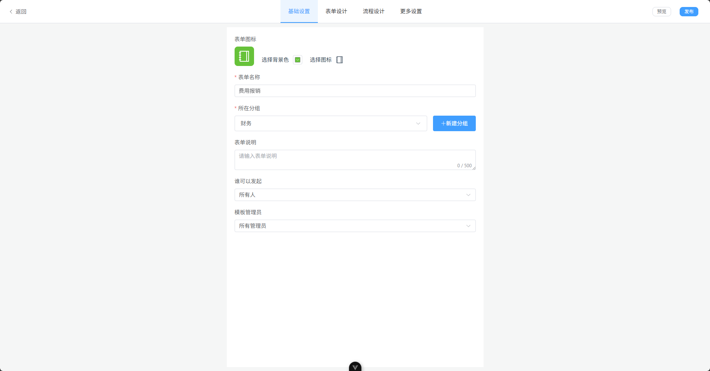
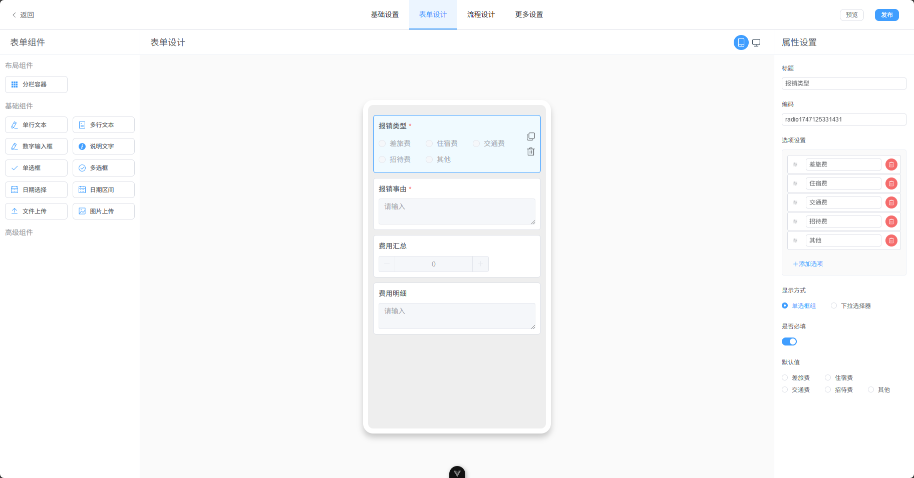
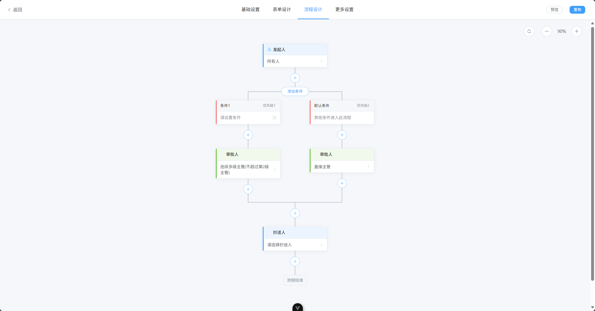
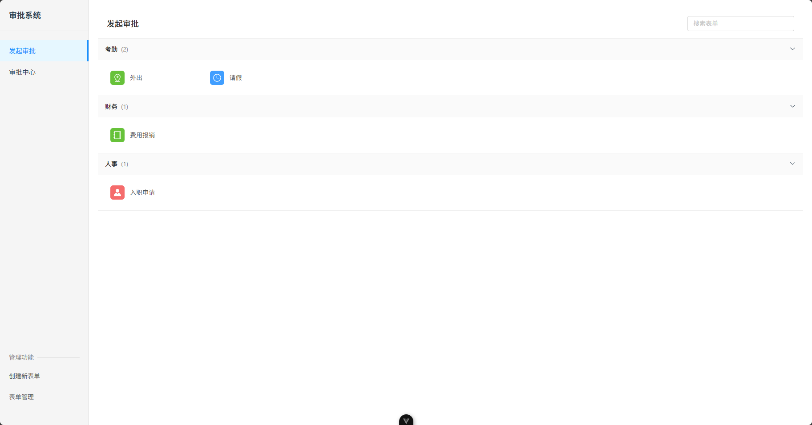
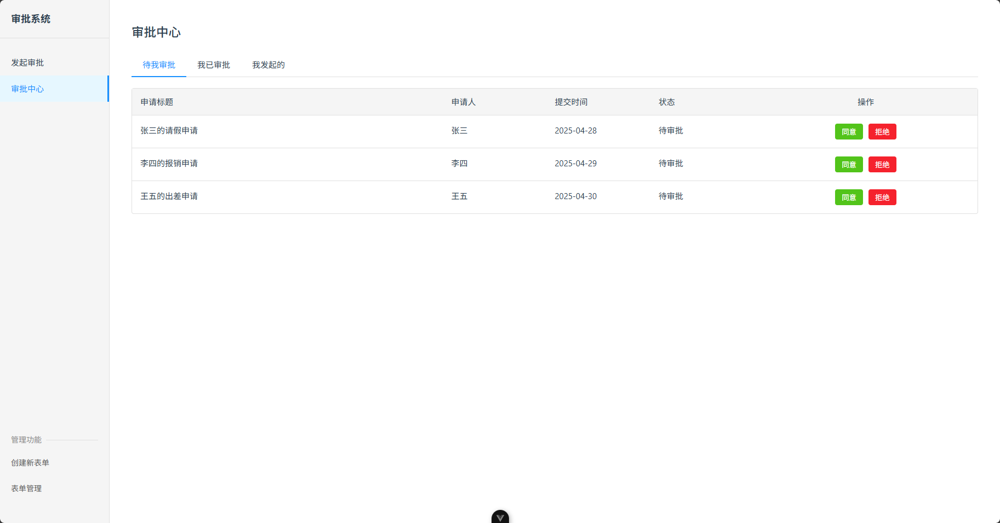
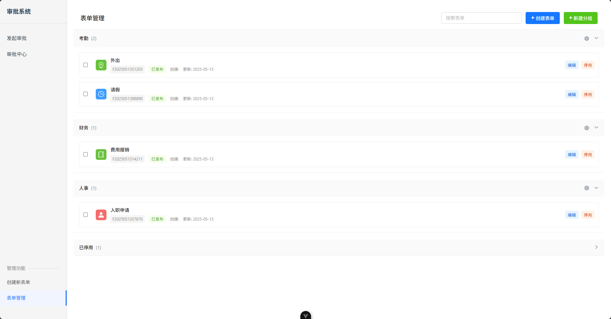

# xflow工作流系统

### 简介

该项目为`xflow工作流系统`的前端。后端还在开发中

前端使用 vue3+element plus ， 实现了`表单设计`、`审批流程设计`、`发起审批`、`评审中心`,`系统管理`功能，使用ai辅助完成。

布局仿照钉钉审批页面，界面简单，易于上手。

**持续更新中，开源不易，可以给个 ⭐ star 鼓励一下**

演示地址：http://8.148.65.254/

#### 作者邮箱

freund99@126.com

### 页面效果图

#### **表单基础设置**



#### **表单设计**



#### **审批流程设计**



#### **发起审批**



#### **评审中心**



#### **表单管理**



<!-- ### 项目结构

```
``` -->
